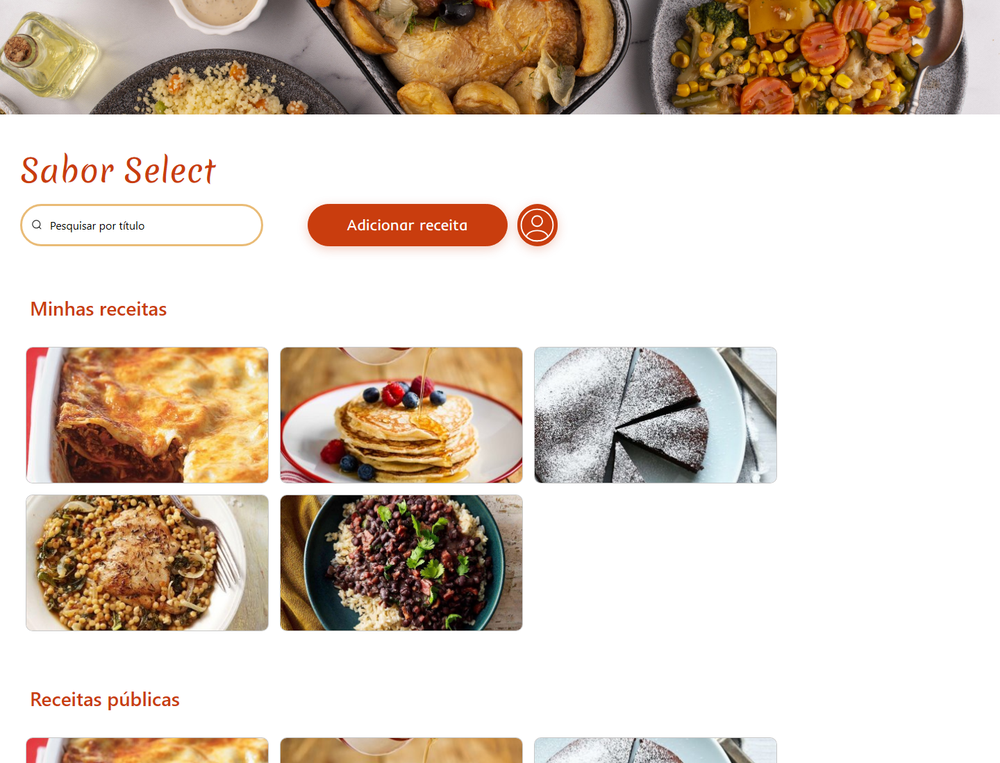
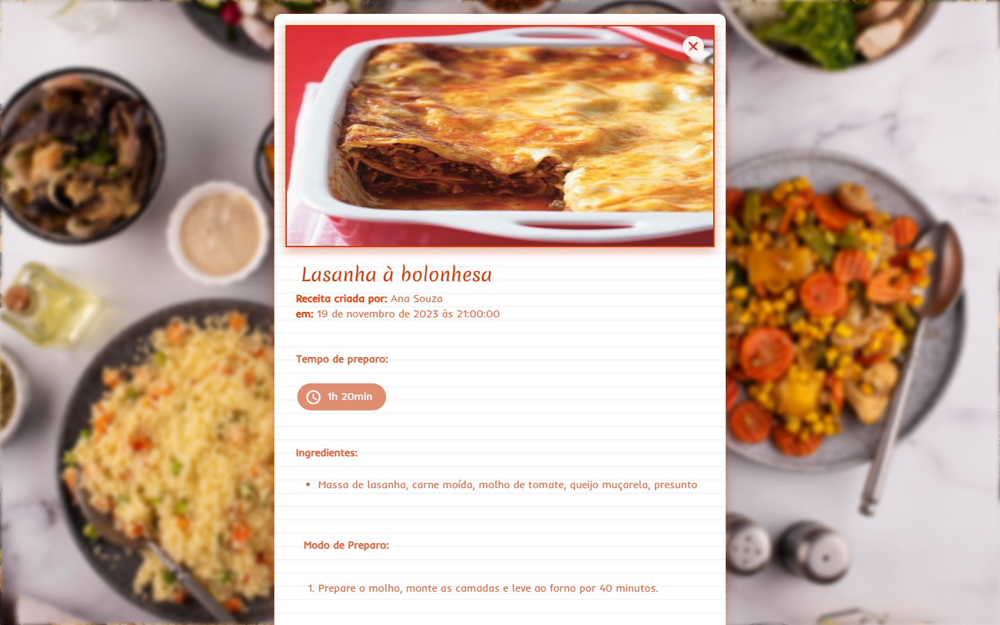
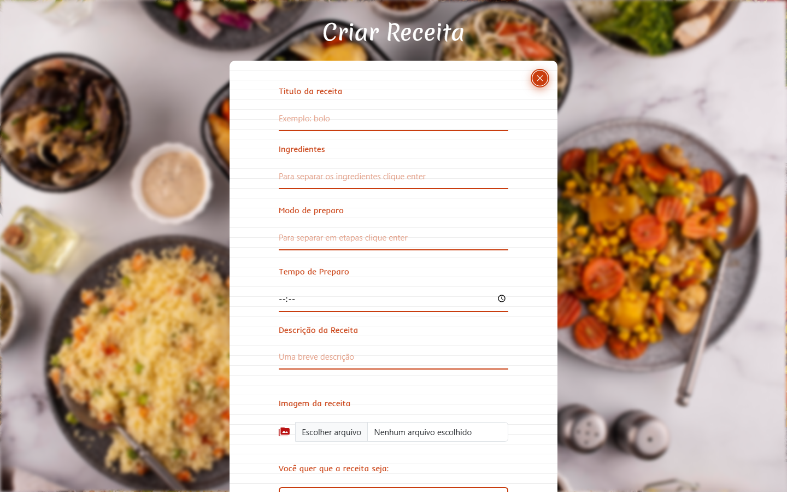
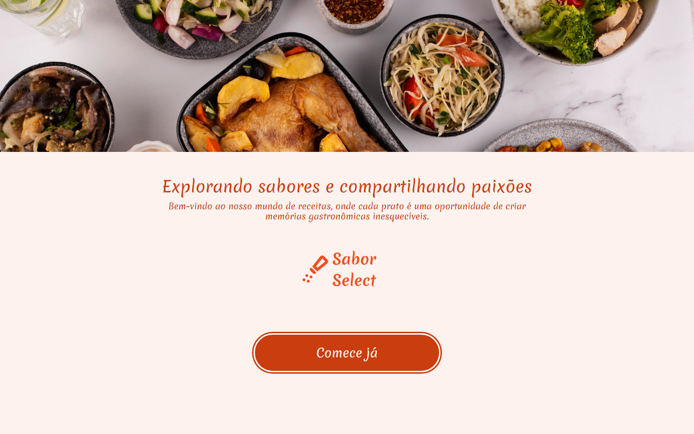
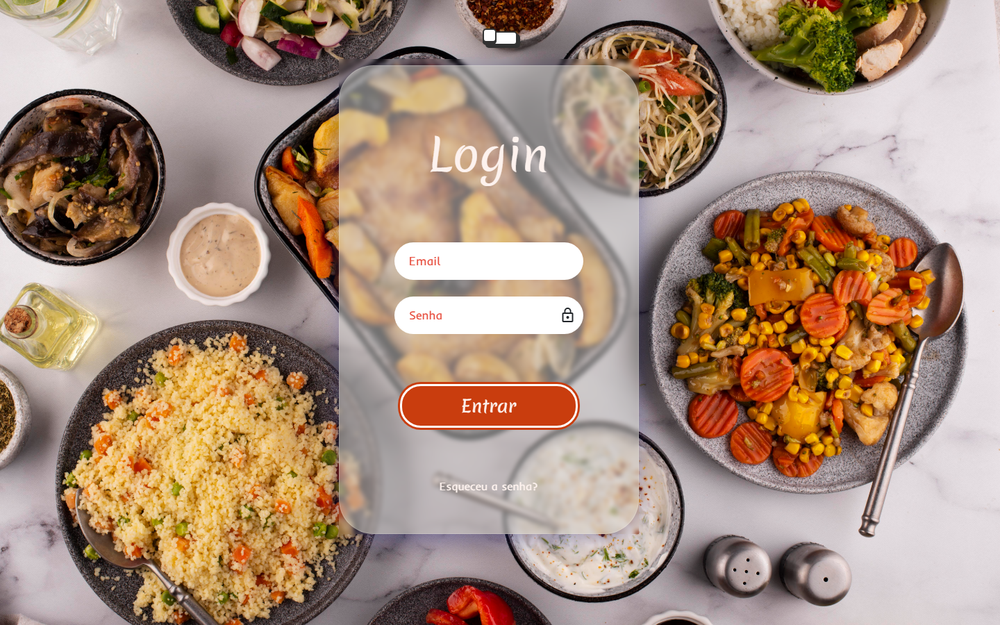

# Sabor Select

[](LICENSE)

Aplicação web de receitas com arquitetura MVC, feita com Node.js, Express, EJS e MySQL. Cada usuário cria sua conta, cadastra receitas com foto, ingredientes e modo de preparo, e escolhe se cada receita é pública ou privada.

> **Projeto de estudo (2023):** meu primeiro projeto full stack com back-end próprio, mantido aqui para mostrar minha evolução como desenvolvedora. O projeto não está hospedado; veja abaixo como executá-lo localmente.

<p align="center">
  
</p>

<p align="center"><em>Minhas receitas e receitas públicas, com busca por título</em></p>

<table>
  <tr>
    <td width="50%"></td>
    <td width="50%"></td>
  </tr>
  <tr>
    <td align="center"><em>Detalhes da receita</em></td>
    <td align="center"><em>Cadastro de uma nova receita</em></td>
  </tr>
  <tr>
    <td width="50%"></td>
    <td width="50%"></td>
  </tr>
  <tr>
    <td align="center"><em>Página inicial</em></td>
    <td align="center"><em>Login</em></td>
  </tr>
</table>

<p align="center"><em>As receitas das imagens são exemplos criados para a demonstração.</em></p>

## Funcionalidades

- Cadastro e login de usuários com sessão
- Redefinição de senha com código enviado por e-mail
- Criação, edição e exclusão de receitas
- Upload da foto da receita
- Receitas públicas, visíveis para todos, e privadas, visíveis só para o autor
- Busca de receitas por título
- Página de detalhes com autor, data, tempo de preparo, ingredientes e modo de preparo
- Página de perfil do usuário
- Organização em Models, Views e Controllers

## Tecnologias

- [Node.js](https://nodejs.org/)
- [Express](https://expressjs.com/)
- [EJS](https://ejs.co/) - renderização das páginas no servidor
- [MySQL](https://www.mysql.com/)
- [express-session](https://github.com/expressjs/session) - sessões de login
- [Multer](https://github.com/expressjs/multer) - upload de imagens
- [Nodemailer](https://nodemailer.com/) - envio de e-mails
- [Bootstrap](https://getbootstrap.com/) - componentes de interface
- [dotenv](https://github.com/motdotla/dotenv) - variáveis de ambiente

## Como Executar

### Pré-requisitos

Antes de começar, tenha instalado:

- [Node.js](https://nodejs.org/)
- npm
- Um servidor [MySQL](https://www.mysql.com/)

### Instalação

Clone o repositório:

```bash
git clone https://github.com/Plovatto/ReceitasMVC.git
```

Acesse a pasta do projeto:

```bash
cd ReceitasMVC
```

Instale as dependências:

```bash
npm install
```

Crie as tabelas no seu banco MySQL:

```bash
mysql -u seu_usuario -p nome_do_banco < database/schema.sql
```

Crie o arquivo de variáveis de ambiente:

```bash
cp .env.example .env
```

Preencha as variáveis em `.env` e execute:

```bash
npm start
```

O projeto estará disponível em:

```text
http://localhost:3000
```

## Variáveis de Ambiente

As variáveis são definidas no arquivo `.env`, que não deve ser versionado.

Utilize `.env.example` como referência:

| Variável         | Descrição                                                        |
| ---------------- | ---------------------------------------------------------------- |
| `PORT`           | Porta do servidor                                                |
| `SESSION_SECRET` | Chave usada para assinar o cookie de sessão                      |
| `DB_HOST`        | Endereço do servidor MySQL                                       |
| `DB_PORT`        | Porta do servidor MySQL (padrão `3306`)                          |
| `DB_USER`        | Usuário do banco                                                 |
| `DB_PASSWORD`    | Senha do banco                                                   |
| `DB_DATABASE`    | Nome do banco                                                    |
| `DB_SSL`         | `true` para bancos que exigem conexão segura                     |
| `GMAIL_USER`     | Conta do Gmail que envia o código de redefinição de senha       |
| `GMAIL_PASS`     | [Senha de app](https://support.google.com/accounts/answer/185833) dessa conta |

### Banco de dados gratuito

O projeto funciona com qualquer banco compatível com MySQL. Uma opção gratuita e sem prazo de expiração é o [TiDB Cloud Starter](https://www.pingcap.com/tidb-cloud-pricing/):

1. Crie um cluster **Starter** e, em **Connect**, gere a senha e copie host, porta, usuário e nome do banco.
2. No **SQL Editor** do TiDB Cloud, crie o banco (`CREATE DATABASE receitas;`) e execute o conteúdo de `database/schema.sql`.
3. Preencha o `.env` com esses dados, usando `DB_PORT=4000` e `DB_SSL=true`.

## Scripts

| Comando     | Descrição            |
| ----------- | -------------------- |
| `npm start` | Inicia o servidor    |

## Estrutura do Projeto

```text
├── controllers/          # Regras de cada fluxo: cadastro, login, perfil, receitas e redefinição
├── database/
│   └── schema.sql        # Estrutura das tabelas do MySQL
├── models/               # Acesso ao banco de dados e envio de e-mails
├── public/
│   ├── images/           # Imagens da interface e fotos enviadas
│   └── styles/           # CSS de cada página
├── routes/               # Rotas do Express
├── views/                # Páginas EJS e layout base
├── docs/                 # Imagens usadas neste README
└── server.js             # Configuração do Express e registro das rotas
```

## Licença

Distribuído sob a [Licença MIT](LICENSE).
